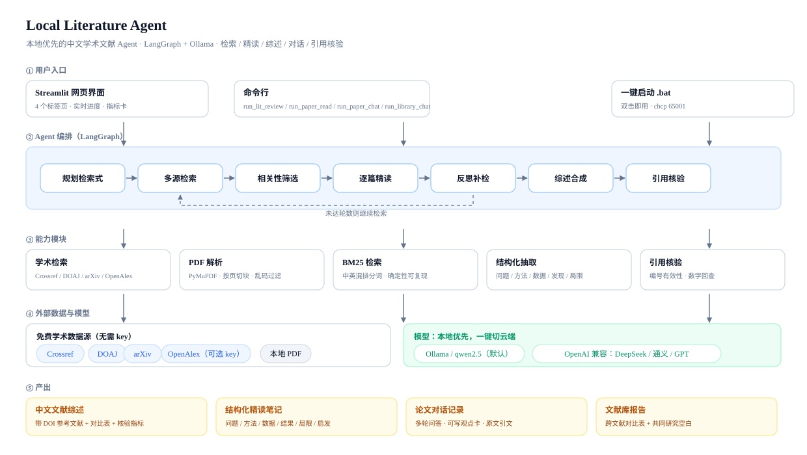
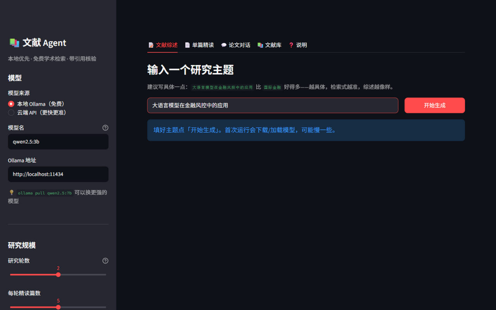
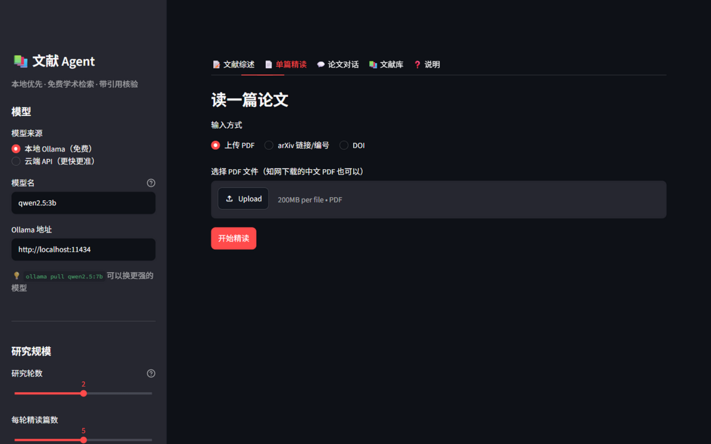
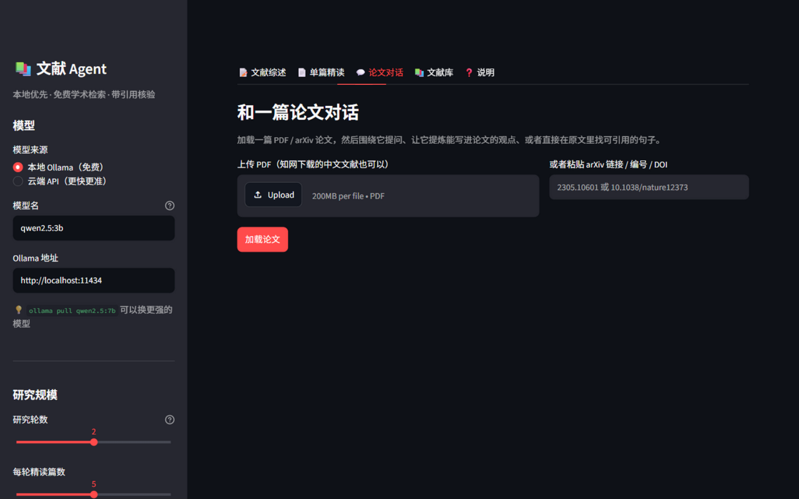
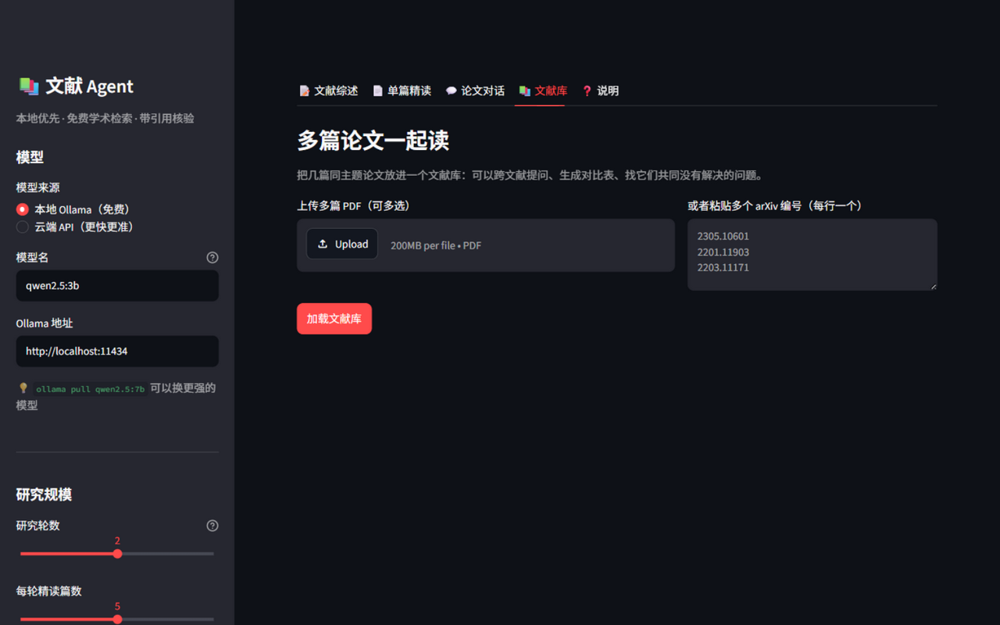

# 📚 Local Literature Agent

> **一个跑在笔记本上的中文学术文献 Agent：检索 → 精读 → 综述 → 引用核验 → 围绕论文对话。**
> 本地模型优先（Ollama），免费学术数据源，带可复现的质量指标。
>
> _A local-first Chinese academic literature agent: retrieval → structured reading →
> literature review → citation verification → paper chat. Built with LangGraph + Ollama._

[]()
[]()
[]()
[]()
[]()



## 界面预览

| 📝 文献综述 | 📄 单篇精读 |
|---|---|
|  |  |
| **💬 论文对话** | **📚 文献库** |
|  |  |

*Streamlit 界面，左侧可切换本地/云端模型、调节研究规模与引用核验开关。*

---

## 为什么做这个

写论文、做行业研究、准备面试时，真实的痛点是：

| 痛点 | 通用 AI 搜索的表现 | 这个项目的做法 |
|---|---|---|
| 搜不准 | 返回新闻、百科、SEO 垃圾 | 检索 **Crossref / DOAJ / arXiv** 学术库，带 DOI |
| 读不完 | 只能一篇篇问 | 一次精读多篇，压成结构化卡片再合成 |
| 留不住 | 读完记不住谁用什么方法 | 每篇生成「问题/方法/数据/发现/局限」卡片，可导出 JSON |
| 引不对 | 编造引用和数字 | 参考文献由程序从元数据生成；引用核验做编号有效性 + 数字回查 |
| 不能追问 | 每次要重新贴论文 | **论文对话 / 文献库对话**：多轮提问、提炼可写观点、摘原文引文 |

---

## 四个能力

| 能力 | 输入 | 输出 | 入口 |
|---|---|---|---|
| **文献综述** | 一个中文研究主题 | 中文综述 + 对比表 + 带 DOI 参考文献 + 核验指标 | `run_lit_review.py` |
| **单篇精读** | PDF / arXiv / DOI | 结构化中文精读笔记 | `run_paper_read.py` |
| **论文对话** | 一篇论文 | 多轮问答 / 可写观点卡 / 原文引文 | `run_paper_chat.py` |
| **文献库对话** | 多篇论文 | 跨文献问答 / 对比表 / 共同研究空白 | `run_library_chat.py` |

外加一个 **Streamlit 网页界面**（`app.py`），5 个标签页：综述 / 精读 / 论文对话 / 文献库 / 说明。

---

## 快速开始

> **前置条件**：Python **3.10+**（本项目在 3.13 上验证）、[Ollama](https://ollama.com/download)。
> 学术检索源（Crossref / DOAJ / arXiv）**不需要任何 API key**。

**最省事：Windows 双击 `一键安装.bat`（macOS 用 `一键安装.command`）**，它会自动完成下面 2-6 步并跑自检。

```bash
# 1. 拿到代码后进入项目目录（克隆或解压）
cd local-literature-agent

# 2. 建虚拟环境（Windows / macOS / Linux 通用）
python -m venv .venv

# 3. 装依赖（二选一，推荐第一种：只用 6 个包）
.venv\Scripts\python.exe -m pip install -r requirements.txt        # Windows
# source .venv/bin/activate && pip install -r requirements.txt      # macOS / Linux
# 或者：pip install -e .   （会以可编辑方式安装 lit_agent 包）

# 4. 拉一个本地模型（约 1.9GB；也可以跳过，改用云端 API）
ollama pull qwen2.5:3b

# 5. 生成配置文件（不配置也能用默认值）
copy .env.example .env        # Windows
# cp .env.example .env        # macOS / Linux

# 6. 自检：检查 模型 / 检索源 / JSON / 引用核验 / 检索，全绿再往下走
.venv\Scripts\python.exe .tools\selftest_lit.py

# 7. 跑第一个综述（1 轮 2 篇，2 分钟左右）
.venv\Scripts\python.exe run_lit_review.py "大语言模型在金融风控中的应用" --rounds 1 --papers 2
```

> ✅ **安装已在「干净环境」验证过**：Python 3.13 + 全新 `pip install -r requirements.txt`
> （6 个包）→ 11 项自检全通过 → 4 个入口脚本与 Streamlit 界面均正常。
> 更细的使用说明见 [使用指南.md](使用指南.md)；
> **5 个真实使用场景**（写论文 / 面试调研 / 读 PDF / 多篇对比 / 找可引用原句）见
> [使用场景与工作流.md](使用场景与工作流.md)；要发给朋友，直接看
> [给朋友的一页说明.md](给朋友的一页说明.md)。

**Windows 一键启动**：环境装好后，双击 `启动界面.bat` 打开网页界面，
或 `运行-文献综述.bat` / `运行-精读论文.bat` / `运行-论文对话.bat`。
（`.bat` 会优先用 `.venv\Scripts\python.exe`；没有 `.venv` 时自动退回系统 `python`——
前提是依赖已经装好。）

**不想用本地模型？** 把 `.env` 里的 `LLM_PROVIDER=openai` 并填 `LIT_API_KEY`，
或者直接在网页界面左侧切换到 DeepSeek / OpenAI / 通义。

<details>
<summary><b>安装排错（点开）</b></summary>

| 现象 | 原因 / 解决 |
|---|---|
| `No module named streamlit` / `fitz` | 只装了 `pip install -e .` 但没装 requirements：执行 `pip install -r requirements.txt` |
| `No module named lit_agent` | 入口脚本会自动把 `src` 加进路径；若仍报错，改用 `pip install -e .` |
| `Ollama 里没有模型 qwen2.5:3b` | 执行 `ollama pull qwen2.5:3b`，或把 `.env` 的 `LOCAL_LLM` 改成 `ollama list` 里有的名字 |
| 连不上 Ollama | 开始菜单打开 Ollama；或命令行 `ollama serve`，确认 `http://localhost:11434` 可访问 |
| pip 装得很慢 | 换国内镜像：`pip install -r requirements.txt -i https://pypi.tuna.tsinghua.edu.cn/simple` |
| Python 版本低于 3.10 | 升级 Python（代码用了 `X | None` 类型语法） |
| 双击 `.bat` 闪退 | `.venv` 不存在或依赖没装，先按上面 2-3 步装好 |

</details>

---

## 实测数据（qwen2.5:3b，纯 CPU，16GB 内存笔记本）

先把指标分成两类，避免"自证式指标"当成绩：

**① 效率（可复现）**

| 指标 | 结果 |
|---|---|
| 一次综述（2 轮 × 4 篇，精读 8 篇） | **约 6 分钟** |
| 单篇精读（4 万字 arXiv 全文） | **约 2.5 分钟** |
| 论文对话首次回答（含中文→英文检索） | **约 20 秒** |
| 检索召回（去重后候选） | **181 篇**（4 条检索式 × 3 个源） |

**② 正确性（结构下限 vs 质量信号，分开看）**

| 指标 | 结果 | 性质 |
|---|---|---|
| 引用编号有效性 | 23/23 = 100% | **结构下限**：参考文献由程序从同一批论文生成，100% 是应有结果，不代表质量 |
| 参考文献完整率 | 8/8 带 DOI 或 arXiv 链接 | 结构下限 |
| 引用覆盖 | 7/8 篇被正文引用 | 结构信号 |
| 数字可追溯率 | 100%（**仅 2 个数字**） | 质量信号，但样本过小，不宣称"准确率" |
| 引用语义支撑率 | 33.3% / 27.3%（同稿两次） | **不可复现，已从主指标降级为可选参考** |

**③ 检索层 A/B 实验**（10 个主题，同一批数据源；v2 为每个主题重复 2 次）

| 条件 | Precision@10（核心概念 + 领域同时命中） | 说明 |
|---|---|---|
| B0 naive | **6.0%** | 直接用中文主题检索，不规划、不约束 |
| B1 检索式 | **57.5%** | 模型生成英文学术检索式 + 多源检索 + 去重打分 |
| B2 hard（v1） | **64.5%** | B1 + 核心概念/领域**硬淘汰** |
| B3 soft（v2） | **62.0%** | B1 + **同义词扩展 + 软惩罚**（当前默认） |

> **诚实解读（这一节比数字重要）**
> 1. **B0→B1 是唯一稳健的结论**：数量级提升，10 个主题里 9 个变好；
> 2. **B1→B2→B3 都在噪声里**：重复运行波动 ±11~14pp，v2 的 62.0% 并不比 v1 的 64.5% 好；
> 3. **v2 上线不是因为它更准，而是因为评测存在"构念效度"问题**——
>    on-topic 判定用 `core/domain` 关键词，硬约束也用同一套词，
>    **指标天然偏向硬约束，看不见"同义表达被误杀"**（这就是典型的自证循环）。
>    所以 v2 消除的是**结构性风险**，它的收益要用**人工标注（100 篇）**才能验证，
>    在验证之前**不宣称 v2 有效**。
> 完整分析：[eval/RESULTS.md](eval/RESULTS.md)；脚本与口径：[`eval/`](eval/)。

**④ 模型对比（本地 3B vs 7B，同一抽取任务）**

| 模型 | 平均耗时/篇 | 有效字段率 | 结论 |
|---|---|---|---|
| qwen2.5:3b | 12.6s | **80%** | 简单论文够用；ToT 这类论文只抽出 2/5 字段 |
| qwen2.5:7b | 35.7s | **100%** | 难题也能抽全，代价是 **2.8× 时间** |

> 这个对比直接支撑了产品的"本地/云端一键切换"：默认 3B（快、免费），
> 需要质量时换 7B 或云端。原始抽取结果附在 [eval/MODEL_COMPARISON.md](eval/MODEL_COMPARISON.md) 里可人工核对。

样例产出（可直接点开看）：
[文献综述](portfolio/demos/review-大语言模型在金融风控.md) ·
[单篇精读](portfolio/demos/reading-Tree-of-Thoughts.md) ·
[论文对话](portfolio/demos/chat-Tree-of-Thoughts.md) ·
[文献库对比](portfolio/demos/library-LLM推理三篇.md)

---

## 关键设计决策

> 完整版见 [case-study.md](portfolio/case-study.md)（产品视角）与 [docs/作品集说明.md](docs/作品集说明.md)。

**1. 检索层决定上限——把网页搜索换成学术检索**
原版工具用 DuckDuckGo，搜"国际金融"返回词典页和新闻站。换源后检索的是期刊、开放获取期刊和预印本。

**2. 检索式必须含核心概念——但约束方式迭代了两版**
模型会把主题词丢掉（"大语言模型在金融风控" → 只搜 `financial risk`）。
v1 用"提示词约束 + 代码补全 + 缺失直接淘汰"，实测发现会误杀同义表达的论文
（supply chain robustness 没有命中 resilience）；v2 改为**同义词扩展 + 软惩罚**
（缺失只扣分不淘汰），默认 `LIT_CONSTRAINT_MODE=soft`。
> 注意：v2 在现有指标上**没有**显著提升——因为指标本身与硬约束同源（见评测章节）。

**3. 不让模型读全文，先压成结构化卡片**
3B 模型上下文有限，卡片既省上下文又让综述结构稳定；参考文献由程序从元数据生成，不让模型"回忆"。

**4. 能用规则算的指标，不交给模型判断**
最初的"引用准确率"让 3B 模型自己判断，同一稿跑两次从 33.3% 变 27.3%——不可复现的指标比没有指标更危险。
最终主指标改为**确定性检查**：编号有效性 + 数字回查 + 引用覆盖；语义抽检降级为可选参考。

**5. 论文对话不上向量库，用词法检索 + 程序回填原文**
一篇论文几十个片段，BM25 足够且可复现；中文提问自动转英文检索；
"提炼观点"时模型只输出句子编号，**原文由程序回填**，从结构上消除"假装引用"。

---

## 技术栈

`Python 3.10+` · `LangGraph`（编排）· `Ollama / OpenAI 兼容接口`（模型，直连 httpx）·
`Crossref / DOAJ / arXiv / OpenAlex`（学术检索）· `PyMuPDF`（PDF 解析）·
`BM25`（纯 Python 实现，无依赖）· `Streamlit`（界面）· `selftest_lit.py`（11 项自检）

> 依赖只有 6 个包（见 `requirements.txt`）：`langgraph`、`httpx`、`python-dotenv`、
> `streamlit`、`pymupdf`、`typing-extensions`。**不需要 langchain**。

## 目录结构

```text
requirements.txt        依赖（6 个包）
.env.example            配置模板（复制成 .env）
run_lit_review.py / run_paper_read.py / run_paper_chat.py / run_library_chat.py
app.py                  Streamlit 5 标签页界面
*.bat                   Windows 一键启动（界面 / 综述 / 精读 / 对话）
src/lit_agent/
  graph.py      综述流水线（LangGraph）
  search.py     学术检索（Crossref / DOAJ / arXiv / OpenAlex）+ 同义词扩展
  verify.py     引用核验（编号有效性 + 数字回查 + 可选语义抽检）
  chat.py       论文对话（BM25 + 观点卡 + 引文）
  library.py    文献库对话（跨文献问答 / 对比 / 研究空白）
  reader.py     单篇精读 / 批量对比
  pdf.py        PDF 解析与切块
  llm.py        模型调用（Ollama / OpenAI 兼容）
  prompts.py    提示词
  config.py     配置
eval/           10 主题检索层 A/B 评测（可复跑）
user_test/      5 人可用性测试套件
portfolio/      产品案例 / 架构图 / 截图 / 样例产出
index.html      个人网站单页（GitHub Pages 可直接用）
.tools/         自检脚本（selftest_lit.py 一键体检）
docs/           作品集说明、上游 README 存档
```

## 已知边界

- 精读基于**摘要**（可配全文），结论需回原文核对；3B 模型会写错数字，**所有数字必须核对**；
- 知网等中文库没有公开 API，走「下载 PDF → 本地解析」的合规路径，不做爬虫；
- 综述是**初稿**，定位是「快速摸清一个领域 + 找到该读的 5-10 篇」，不是终稿。

## 路线图

- [x] 多源学术检索 + 相关性硬约束
- [x] 结构化精读 + 中文综述 + DOI 参考文献
- [x] 确定性引用核验（编号 + 数字回查）
- [x] Streamlit 界面 + 云端模型一键切换
- [x] 论文对话（问答 / 观点卡 / 引文）
- [x] 文献库对话（跨文献对比 / 研究空白）
- [x] 10 主题检索层 A/B 评测（发现"硬约束误杀同义词"的负面结果）
- [x] 用户测试套件（主试话术 / 任务卡 / 计时器 / SUS / 自动分析）——**待采集 5 人数据**
- [x] 模型对比（3B vs 7B）：有效字段 80%→100%，耗时 2.8×
- [x] v2 同义词扩展 + 软惩罚（默认 `LIT_CONSTRAINT_MODE=soft`）——**实测未提升 Precision@10，理由是评测构念效度问题**
- [ ] **人工标注 100 篇**（2 人交叉）验证 v2 的召回收益——这是"v2 是否真的更好"的唯一可信方式
- [ ] 5 人可用性测试（套件已就绪，跑完把结果贴进 `user_test/results/RESULTS.md`）
- [ ] 引文滚雪球（OpenAlex referenced_works / cited_by）

---

## 当前状态边界（诚实说明）

- ✅ 技术原型：五个入口 + 网页界面 + 11 项自检，可完整跑通；
- ✅ 检索层有对照实验（10 主题 A/B，含 repeat），并如实报告了负面结果；
- ✅ v2 软惩罚已上线，但**其收益尚未被验证**（现有指标测不出来，需人工标注）；
- ⚠️ **用户验证尚未完成**：测试套件已就绪，但还没有真实被试数据；
- ⚠️ 3B 本地模型输出质量有限，样例均为**原始输出、未人工润色**。

## 致谢与许可

本项目基于 [langchain-ai/local-deep-researcher](https://github.com/langchain-ai/local-deep-researcher)
的 LangGraph 骨架改造（原版 README 存档于 [docs/上游README-原版.md](docs/上游README-原版.md)），
保留原仓库的 **MIT License 与版权声明**；新增的文献 Agent 代码同样采用 MIT。
完整的来源、改动范围、第三方依赖许可与数据合规说明见 [ATTRIBUTION.md](ATTRIBUTION.md)。

> - 新版的文献 Agent 已不再依赖原版的 langchain 组件，只保留 `langgraph` 作为编排层；
> - 本项目为个人学习/作品集项目，与上游作者及 LangChain 官方**没有隶属或背书关系**。

