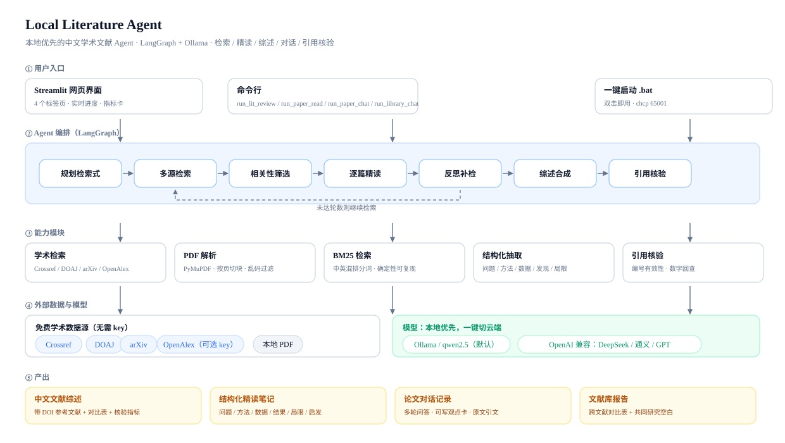

# 产品案例：本地文献 Agent

> 这是给**个人网站 / 作品集 / 面试**用的产品视角文档。
> 技术细节在 [README](../README.md)，完整设计说明在 [作品集说明](../docs/作品集说明.md)。

## 一句话

**把"读一个领域的文献"从几天压缩到一小时：检索学术库、逐篇结构化精读、生成带 DOI 的中文综述，
并用确定性检查告诉你哪些引用和数字需要人工核对。**

---

## 一、用户与场景

| 用户 | 场景 | 现在怎么做 | 痛点 |
|---|---|---|---|
| 写开题报告的本科生 / 研究生 | 需要 20-30 篇文献的综述初稿 | 知网逐篇下载、手动整理 | 读不完、记不住、引用格式烦 |
| 做行业研究的产品 / 分析师 | 快速摸清一个技术方向 | ChatGPT 搜索 + 人工读 | 搜到的常是新闻，引用不可靠 |
| 准备面试的求职者 | 3 天摸熟一个细分领域 | 看二手博客 | 观点没有出处，经不起追问 |

**Job to be done**：给我一个主题，让我在 1 小时内知道「这个领域谁在做什么、方法有什么分歧、
哪些结论有数据支撑、我该读哪 10 篇」。

---

## 二、问题拆解

"读文献"其实是 5 个任务，市面产品大多只解决 1 个：

| 任务 | 现有产品 | 本项目 |
|---|---|---|
| ① 找到该读的文献 | 通用 AI 搜索（不准） | 学术库检索 + 相关性硬约束 |
| ② 读懂单篇 | ChatPDF 类（成熟） | 结构化精读卡片 |
| ③ 横向对比多篇 | 几乎没有 | 对比表 + 对比综述 |
| ④ 写成综述初稿 | 几乎没有 | 主题化中文综述 + DOI 参考文献 |
| ⑤ 核对引用是否可信 | 没有 | 编号有效性 + 数字回查 |

差异化的关键是 ①③④⑤——②已经不是问题了，**"找 + 比 + 写 + 核" 才是空档**。

---

## 三、方案与架构



四个能力对应四类产出：综述、精读笔记、论文对话、文献库报告。
统一跑在本地 Ollama 上（默认免费、数据不出本机），也可以在界面里一键切换 DeepSeek / OpenAI / 通义。

---

## 四、关键取舍（面试重点）

### 1. 换数据源，而不是优化提示词
第一版沿用了原仓库的 DuckDuckGo 网页搜索。搜"国际金融"，返回的是词典页（latest / common 的中文释义）
和新闻站——**不是模型不行，是数据源不对**。换成 Crossref / DOAJ / arXiv 后，
同样的问题才第一次出现真正的期刊论文。
> 迁移经验：**检索质量是生成质量的上限，提示词救不了错的数据源。**

### 2. 加"相关性硬约束"，而不是相信模型
模型生成检索式时会丢主题词。第一版跑出来综述里全是"金融欺诈检测"，一个字没提大语言模型。
解法是三层：提示词要求 → 代码兜底补全 → 打分惩罚（完全不提核心概念的论文直接淘汰）。
> 迁移经验：**模型的指令依从性不可靠时，用代码兜底，而不是反复改提示词。**

### 3. 不做"模型自评"，只做"规则可算"
最初我让 3B 模型逐句判断"引用是否有依据"，做成"引用准确率"。
结果同一份稿子跑两次：**33.3% → 27.3%**。小模型给自己打分不稳定，这个指标既不能对外展示，
也不能指导迭代。最终把主指标换成确定性检查：
- 编号有效性（正文 `[n]` 是否对应真实参考文献）
- 数字回查（正文的百分比/样本量能否在所引论文里找到）
- 引用覆盖（有没有"挂着没用到"的文献）

语义抽检降级为可选参考，并在 UI 里明确标注"仅供参考"。
> 迁移经验：**不可复现的指标比没有指标更危险**——它会误导用户，也会误导迭代方向。

### 4. 论文对话不上向量库
一篇论文只有几十个片段，BM25 词法检索就够，而且**同样的提问永远命中同样的原文**（可复现、可核对页码）。
中文提问先转英文关键词再检索（否则英文论文召回为 0）。
> 迁移经验：**先判断问题规模**。几十个片段的检索场景，引入 embedding + 向量库是过度设计。

### 5. 原文不由模型复述，由程序回填
小模型会"假装引用"——让它照抄原文，它直接把提示词里的占位文字填回来。
解法：把片段拆成带编号的句子（`[p3-s2]`），模型只输出编号，程序回填真实原句。
> 迁移经验：**把可靠性交给代码**：能让程序算的，不要让模型生成。

---

## 五、数据与验证

| 指标 | 结果 | 说明 |
|---|---|---|
| 端到端耗时 | 约 6 分钟 / 8 篇 | qwen2.5:3b，CPU，16GB 笔记本 |
| 检索召回 | 181 篇候选 | 4 条检索式 × 3 个源 |
| 引用编号有效率 | 100%（23/23） | 确定性检查 |
| 数字可追溯率 | 100% | 确定性检查；样例稿仅 2 个数字，样本小 |
| 参考文献完整率 | 100%（8/8 带 DOI/链接） | 程序从元数据生成 |
| 已知 badcase | ToT 论文 74% 被写成 87.8% | 3B 数字幻觉，已写入反幻觉提示词，仍需人工核对 |

**验证方式**：自检脚本 10 项全通过（模型 / 3 个检索源 / JSON 能力 / 引用核验 / BM25 检索）；
样例产出可逐条点开核对（见 README 的 demos）。

---

## 六、失败与迭代

| 版本 | 做了什么 | 结果 | 学到什么 |
|---|---|---|---|
| v0 | 原仓库网页研究工具 | 搜"国际金融"返回词典页 | 数据源错了，提示词救不了 |
| v1 | 换学术源 + 结构化精读 | 综述能看，但选出的论文跑题 | 需要相关性硬约束 |
| v2 | 硬约束 + 打分惩罚 | 论文对口了，但引用无法验证 | 需要引用核验 |
| v3 | 确定性核验（编号 + 数字回查） | 指标可复现、可疑点可定位 | 规则能算的别交给模型 |
| v4 | 论文对话 / 文献库对话 | 从"读一次"变成"持续追问" | 检索可复现 + 原文程序回填 |
| v5 | v2 软惩罚 + 同义词扩展 | 精度没变（噪声内），但消除了误杀风险 | **指标和机制同源时，指标测不出自己的问题** |

---

## 七、边界与风险

- **幻觉**：3B 模型会写错数字，所以定位是「初稿 + 线索」，所有数字必须回原文核对；
- **合规**：知网没有公开 API，**不做爬虫**，走「用户下载 PDF → 本地解析」的合规路径；
- **模型能力**：3B 在跨语言理解、长文归纳上明显弱于 7B / 云端模型，所以设计成可一键切换；
- **不是"替写论文"**：只提供观点卡和引用素材，写作仍由人完成。

---

## 八、自我批判：上一版会被面试官一眼看穿的三处

做完第一版作品集后，我按"面试官会怎么怼我"重新审了一遍，找到三个问题，并做了修正：

### 问题 1：把"自证式指标"当成质量指标

**原表述**："引用编号有效率 100%"。
**问题**：参考文献本来就是程序从同一批论文生成的，编号当然 100% 有效——这是**结构性下限**，
不是质量。把它当成绩展示，反而暴露了"不会区分指标"。
**修正**：
- 把指标拆成两类：**结构正确性**（编号有效、引用覆盖，属于下限保证）
  与**质量信号**（数字回查、人工抽查）；
- 明确写出"数字可追溯率 100% 只基于 2 个数字，样本太小，不宣称质量"；
- 增加真正的对照实验（见第九节）。

### 问题 2：没有 baseline，所有结论都是自说自话

**原表述**："换了学术源之后结果更相关"。
**问题**：没有对照，无法证明这是"设计好"还是"任务简单"。
**修正**：做了 `eval/` 检索层 A/B 实验，同一批 10 个主题、同一批数据源，跑四种条件：

| 条件 | 做法 | Precision@10 |
|---|---|---|
| B0 naive | 直接用中文主题检索（无规划、无约束） | **6.0%** |
| B1 检索式 | 模型生成英文学术检索式 + 多源检索 + 去重打分 | **57.5%** |
| B2 hard（v1） | B1 + 核心概念/应用领域**硬淘汰** | **64.5%** |
| B3 soft（v2） | B1 + **同义词扩展 + 软惩罚** | **62.0%** |

**但真正有价值的是后面三件事**（详见 [eval/RESULTS.md](../eval/RESULTS.md)）：

1. **重复运行发现噪声很大**：同一主题两次跑，B1 能从 80% 掉到 30%（检索源实时变化 +
   模型生成检索式的随机性）。所以 +6pp、-2.5pp **都不能宣称显著**；
2. **逐篇对比发现"误杀"**：硬约束淘汰掉的论文里，有不少其实是相关的
   （*Whose resilience matters? ... supply chain resilience* 只因没命中我定义的关键词被淘汰）；
3. **v2 上线后，指标测不出它的好处**——这暴露了更根本的问题：
   **on-topic 判定和硬约束用的是同一套关键词，指标天然偏向硬约束**，
   "同义表达被误杀"在指标里根本不可见（被误杀的按定义就算 off-topic）。
   这是典型的**构念效度问题：评测在测自己**。

所以：v2 的价值不是"精度更高"，而是**消除结构性风险**；要证明它的召回收益，
必须用**人工标注（100 篇、2 人交叉）**换掉关键词判定。在验证之前，作品集里**不宣称 v2 有效**。

### 问题 3：没有用户验证

**诚实承认**：目前只有作者自用，没有真实用户测试、没有任务完成时间对照。
这一条**不假装有**，但已经把测试套件做完了（`user_test/`：主试话术、任务卡、计时器、SUS 问卷、
自动分析脚本）——找 5 个同学各跑 60 分钟即可产出：

- 任务 1：找 10 篇相关文献，手工 vs 工具的耗时与相关篇数；
- 任务 2：3 条观点里能直接用的比例；
- SUS 主观可用性得分 + 卡点分布 + 原话反馈。

> 在当前状态下，作品的定位是「**技术原型 + 自测 + 评测方案就绪**」，
> 不是「已验证的产品」。这条边界会明写在 README 里。

---

## 九、评测设计（可复现）

```bash
python eval/run_eval.py --repeat 2 --out v2      # 10 主题 × 4 条件 × 2 次重复
python eval/run_eval.py --topics supply_chain --out regress   # 单项复跑/诊断
```

- **标注口径**：每个主题人工定义 `core_terms` 与 `domain_terms`，标题/摘要同时命中才算 on-topic；
- **指标**：Precision@10、Core@10、Domain@10（后两个用来定位是哪一环失效）；
- **对照组**：B0 无约束 / B1 只做检索式 / B2 硬淘汰（v1）/ B3 软惩罚（v2）；
- **重复运行**：`--repeat N` 取均值 + 记录同主题极差（噪声估计）；
- **输出**：`eval/v2.json` + `eval/v2.md`，任何人可复跑；
- **已知噪声**：重复运行波动 ±11~14pp，结论只看数量级差异；
- **已知效度问题**：关键词判定与硬约束同源，看不见"同义词误杀"（见第九节结尾）。

**局限也写在评测文档里**：关键词代理标注、10 个主题、只覆盖检索层、单次运行有噪声。

### 补充：模型对比（3B vs 7B）

同一个抽取任务、同一批论文：

| 模型 | 平均耗时/篇 | 有效字段率 |
|---|---|---|
| qwen2.5:3b | 12.6s | **80%**（ToT 这类论文只抽出 2/5 字段） |
| qwen2.5:7b | 35.7s | **100%** |

结论不是"越大越好"，而是**给出可选的取舍**：默认 3B（快、免费、够用于简单论文），
质量敏感时切 7B 或云端（2.8× 时间）。原始抽取结果可逐条核对。

---

## 十、可迁移的方法论（AI 产品五条）

1. **先修数据，再调提示词**：模型表现差，先怀疑检索 / 上下文，而不是立刻换更大的模型；
2. **指标要可复现**：能用规则算的指标优先；模型自评只能当参考，且必须在 UI 里标注；
3. **可信度来自结构**：引用由程序生成、原文由程序回填、核验由规则完成——
   在模型不可靠的地方，用工程手段把错误"卡死"；
4. **指标要能证伪**：任何"提升了"的结论，都要有对照组；没有 baseline 的优化是自我感动；
5. **指标不能和机制同源**（构念效度）：如果评测口径和你的设计用的是同一套规则，
   指标就只会告诉你"设计符合自己的定义"。这时候要么换标注方式（人工/AI+抽检），
   要么诚实地说"这个指标测不出来"。

---

## 十一、如果继续做

1. **人工标注 100 篇**（2 人交叉）：这是验证 v2 召回收益的唯一可信方式，优先级最高；
2. **5 人可用性测试**：记录"找到并读完 10 篇文献"的时间，对比手工流程；
3. **大纲驱动写作**（借鉴 STORM）：先出综述大纲，再按小节缺口补检索；
4. **引文滚雪球**（OpenAlex `referenced_works` / `cited_by`）：提升综述召回。
